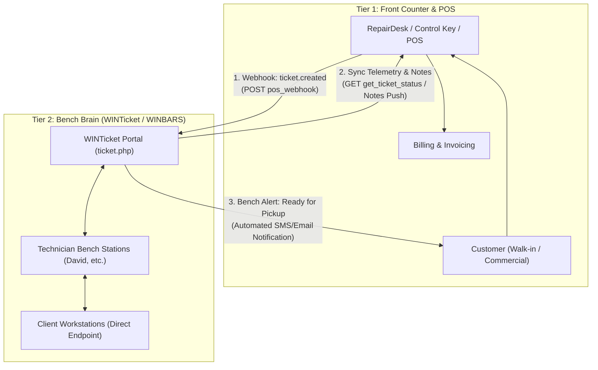

# WINTicket & POS Integration Specification (Schema Pack)
**Version:** 2.1.0  
**Target Systems:** Control Key Ticketing, RepairDesk POS, RepairQ, Square, Custom Shop CRMs  
**Protocol:** RESTful HTTPS JSON / Webhooks  
**Endpoint Architecture:** Two-Tiered POS + Bench Brain Integration  

---

## 1. Architectural Overview: The "Bench Brain" Paradigm

### The Two-Tier System
Repair shops and MSPs operate on two fundamentally different planes:
1. **Tier 1 — Point of Sale (POS) / CRM / Billing (RepairDesk, Control Key, RepairQ):**
   - Manages customers, invoices, credit card payments, inventory/parts ordering, labor hours, and pickup scheduling.
   - Built for the front counter, cash registers, and accounting.
2. **Tier 2 — Bench Brain & Direct-Endpoint Controller (WINTicket / WINBARS / WINTOOLS):**
   - Interacts directly with bare-metal Windows workstations on the repair bench and in the field.
   - Collects live hardware diagnostics (SMART disk health, NVMe wear, thermal throttling, RAM integrity, battery cycles).
   - Manages security posture (BitLocker DRA escrow, silent Shadow Copy backups, RAT detection, threat isolation).
   - Operates with a **Zero-Phone-Home / Local Air-Gapped** architecture.



By connecting these two tiers:
- The technician never re-types customer names, phones, or ticket numbers on the bench.
- The front desk POS automatically receives technical diagnostic summaries, BitLocker DRA key escrow verification, and "Ready for Pickup" status without phone tag.
- The customer receives transparent, professional diagnostic reports with proof of services rendered.

---

## 2. API Endpoints Reference

Base URL: `https://macpc.remarkablepc.com/api/ticket.php` (or your internal shop host)  
Authentication: URL query parameter `?key={DASHBOARD_SECRET_KEY}` or HTTP Header `X-API-Key: {DASHBOARD_SECRET_KEY}`.

### 2.1 Ingest Ticket from POS / Webhook
Synchronizes an intake work order from RepairDesk or Control Key into WINTicket.

- **Endpoint:** `POST /api/ticket.php?action=pos_webhook&key={SECRET_KEY}` (or `action=sync_ticket`)
- **Headers:** `Content-Type: application/json`
- **Request Body (JSON):**
```json
{
  "event": "ticket.created",
  "ticket": {
    "ticket_id": "RPC-2026-104",
    "pos_source": "ControlKey",
    "customer_name": "Sarah Connor",
    "customer_phone": "(828) 555-0144",
    "customer_email": "sconnor@skyguard.com",
    "customer_type": "residential",
    "serial_number": "PF4X98A1",
    "computer_name": "Sarah-ThinkPad",
    "brand": "Lenovo",
    "model": "ThinkPad T14 Gen 3",
    "technician": "David",
    "intake_notes": "Customer reports laptop shutting down randomly while gaming; requested thorough dust blow-out, malware scan, and storage health check.",
    "status": "In Diagnosis"
  }
}
```

- **Successful Response (200 OK):**
```json
{
  "status": "success",
  "message": "Ticket synced into WINTicket fleet",
  "ticket_id": "RPC-2026-104",
  "machine_key": "Sarah-ThinkPad",
  "created_at": "2026-10-19 00:15:00"
}
```

---

### 2.2 Query Real-Time Bench Status & Diagnostics
Used by Control Key or RepairDesk to display live hardware health and bench progress in the POS ticket view.

- **Endpoint:** `GET /api/ticket.php?action=get_ticket_status&key={SECRET_KEY}&serial={SERIAL}&ticket_id={TICKET_ID}`
- **Successful Response (200 OK):**
```json
{
  "status": "success",
  "machine_key": "Sarah-ThinkPad",
  "ticket_id": "RPC-2026-104",
  "serial": "PF4X98A1",
  "technician": "David",
  "diagnostics": {
    "health_status": "Healthy",
    "smart_health": "PASS (98% Life Remaining, NVMe temp 41C)",
    "battery_wear_pct": 11.4,
    "ram_total_gb": 32,
    "pending_reboot": false,
    "pending_updates": 0,
    "threats_detected": 0,
    "bitlocker_status": {
      "c_drive_encrypted": true,
      "recovery_key_escrowed": true,
      "method": "XTS-AES-256"
    },
    "backup_status": {
      "shadow_copies_active": true,
      "last_snapshot": "2026-10-19 08:30:12"
    }
  },
  "bench_actions": [
    "WINBARS Diagnostic Baseline Created",
    "Thermal Throttling Cleared (Cleaned heatsink fan)",
    "Scam Sentry RAT Scan Clean",
    "Disaster Recovery Image Verified"
  ],
  "is_ready_for_pickup": true,
  "last_telemetry_at": "2026-10-19 11:22:04"
}
```

---

### 2.3 Batch Operations (Fleet Management)
Perform batch operations across multiple workstations simultaneously.

- **Batch Add Tag:** `POST /api/ticket.php?action=batch_add_tag&key={SECRET_KEY}`
  ```json
  { "machine_keys": ["Sarah-ThinkPad", "David-OptiPlex"], "tag": "Ready for Pickup" }
  ```
- **Batch Reassign Technician:** `POST /api/ticket.php?action=batch_reassign_tech&key={SECRET_KEY}`
  ```json
  { "machine_keys": ["Sarah-ThinkPad", "David-OptiPlex"], "technician": "Bethany" }
  ```
- **Batch Archive Workstations:** `POST /api/ticket.php?action=batch_archive&key={SECRET_KEY}`
  ```json
  { "machine_keys": ["Sarah-ThinkPad", "David-OptiPlex"] }
  ```

---

## 3. Formal JSON Schema Definitions

### 3.1 POS Ingestion Schema (`pos_ticket_sync.schema.json`)
```json
{
  "$schema": "https://json-schema.org/draft/2020-12/schema",
  "title": "POSTicketSync",
  "description": "Payload sent by POS (RepairDesk/Control Key) to ingest or update a work order in WINTicket",
  "type": "object",
  "required": ["ticket"],
  "properties": {
    "event": {
      "type": "string",
      "enum": ["ticket.created", "ticket.updated", "ticket.status_change"]
    },
    "ticket": {
      "type": "object",
      "required": ["ticket_id", "customer_name"],
      "properties": {
        "ticket_id": { "type": "string", "description": "Shop POS ticket or invoice number" },
        "pos_source": { "type": "string", "enum": ["ControlKey", "RepairDesk", "RepairQ", "Other"] },
        "customer_name": { "type": "string", "minLength": 1 },
        "customer_phone": { "type": "string" },
        "customer_email": { "type": "string", "format": "email" },
        "customer_type": { "type": "string", "enum": ["residential", "commercial", "bench_station"] },
        "serial_number": { "type": "string" },
        "computer_name": { "type": "string" },
        "brand": { "type": "string" },
        "model": { "type": "string" },
        "technician": { "type": "string" },
        "intake_notes": { "type": "string" },
        "status": { "type": "string", "enum": ["Open", "In Diagnosis", "Waiting on Parts", "Ready for Pickup", "Closed"] }
      }
    }
  }
}
```

### 3.2 Telemetry Export Schema (`winticket_telemetry.schema.json`)
```json
{
  "$schema": "https://json-schema.org/draft/2020-12/schema",
  "title": "WINTicketTelemetryExport",
  "description": "Diagnostic and hardware posture exported from WINTicket back to POS or customer portal",
  "type": "object",
  "required": ["ticket_id", "machine_key", "diagnostics", "status"],
  "properties": {
    "status": { "type": "string", "enum": ["success", "error"] },
    "ticket_id": { "type": "string" },
    "machine_key": { "type": "string" },
    "serial": { "type": "string" },
    "technician": { "type": "string" },
    "diagnostics": {
      "type": "object",
      "properties": {
        "health_status": { "type": "string", "enum": ["Healthy", "Warning", "Threat"] },
        "smart_health": { "type": "string" },
        "battery_wear_pct": { "type": "number", "minimum": 0, "maximum": 100 },
        "ram_total_gb": { "type": "integer" },
        "pending_reboot": { "type": "boolean" },
        "pending_updates": { "type": "integer" },
        "threats_detected": { "type": "integer" },
        "bitlocker_status": {
          "type": "object",
          "properties": {
            "c_drive_encrypted": { "type": "boolean" },
            "recovery_key_escrowed": { "type": "boolean" },
            "method": { "type": "string" }
          }
        },
        "backup_status": {
          "type": "object",
          "properties": {
            "shadow_copies_active": { "type": "boolean" },
            "last_snapshot": { "type": "string" }
          }
        }
      }
    },
    "bench_actions": {
      "type": "array",
      "items": { "type": "string" }
    },
    "is_ready_for_pickup": { "type": "boolean" },
    "last_telemetry_at": { "type": "string" }
  }
}
```

---

## 4. Integration Code Snippets for Control Key (Coworker Handoff)

### 4.1 Node.js / TypeScript (Express Webhook Dispatcher)
Give this to your coworker building Control Key with ChatGPT/Antigravity:

```typescript
import axios from 'axios';

interface ControlKeyTicket {
  ticketNumber: string;
  customerName: string;
  customerPhone: string;
  customerEmail?: string;
  machineSerial: string;
  machineName: string;
  assignedTech: string;
  intakeNotes: string;
  status: string;
}

const WINTICKET_API_URL = 'https://macpc.remarkablepc.com/api/ticket.php';
const WINTICKET_API_KEY = 'rpc2026';

/**
 * Pushes ticket creation/update from Control Key to WINTicket
 */
export async function pushTicketToWINTicket(ticket: ControlKeyTicket) {
  try {
    const payload = {
      event: 'ticket.created',
      ticket: {
        ticket_id: ticket.ticketNumber,
        pos_source: 'ControlKey',
        customer_name: ticket.customerName,
        customer_phone: ticket.customerPhone,
        customer_email: ticket.customerEmail || '',
        customer_type: 'residential',
        serial_number: ticket.machineSerial,
        computer_name: ticket.machineName,
        technician: ticket.assignedTech,
        intake_notes: ticket.intakeNotes,
        status: ticket.status
      }
    };

    const response = await axios.post(
      `${WINTICKET_API_URL}?action=pos_webhook&key=${encodeURIComponent(WINTICKET_API_KEY)}`,
      payload,
      { headers: { 'Content-Type': 'application/json' } }
    );

    console.log(`[WINTicket Sync] Successfully synced ${ticket.ticketNumber}:`, response.data);
    return response.data;
  } catch (error: any) {
    console.error(`[WINTicket Sync] Failed to sync ${ticket.ticketNumber}:`, error.message);
    throw error;
  }
}

/**
 * Fetches real-time bench diagnostic summary to display inside Control Key
 */
export async function getLiveBenchHealth(serial: string, ticketNumber: string) {
  const url = `${WINTICKET_API_URL}?action=get_ticket_status&key=${encodeURIComponent(WINTICKET_API_KEY)}&serial=${encodeURIComponent(serial)}&ticket_id=${encodeURIComponent(ticketNumber)}`;
  const res = await axios.get(url);
  return res.data;
}
```

### 4.2 PowerShell (Automated Bench Dispatch)
```powershell
$WinticketUrl = "https://macpc.remarkablepc.com/api/ticket.php"
$ApiKey       = "rpc2026"

$TicketPayload = @{
    event = "ticket.created"
    ticket = @{
        ticket_id      = "RPC-2026-105"
        pos_source     = "BenchScript"
        customer_name  = "Acme Legal LLC"
        customer_phone = "(828) 555-9000"
        customer_type  = "commercial"
        serial_number  = "5CD23489K"
        computer_name  = "Acme-FrontDesk"
        technician     = "David"
        intake_notes   = "Quarterly health audit & BitLocker verification"
        status         = "In Diagnosis"
    }
} | ConvertTo-Json -Depth 5

$response = Invoke-RestMethod -Uri "$WinticketUrl`?action=pos_webhook&key=$ApiKey" `
    -Method Post `
    -ContentType "application/json" `
    -Body $TicketPayload

Write-Host "Sync status: $($response.status) - $($response.message)" -ForegroundColor Green
```

---

## 5. RepairDesk & Customer Connection Roadmap

### 5.1 Connecting to RepairDesk POS
RepairDesk is specialized for retail sales, invoicing, and work orders. It supports both inbound webhooks and REST APIs:

1. **Inbound Webhook from RepairDesk to WINTicket:**
   - In RepairDesk, go to **Settings -> Integrations -> Webhooks**.
   - Create a webhook trigger for `Ticket Create` and `Ticket Update`.
   - Set the Payload URL to:  
     `https://macpc.remarkablepc.com/api/ticket.php?action=pos_webhook&key=rpc2026`
   - Whenever an intake specialist checks in a computer in RepairDesk, WINTicket automatically generates or links the workstation card on the bench dashboard.

2. **Outbound Diagnostic Push (WINTicket to RepairDesk):**
   - RepairDesk exposes an API endpoint to post internal or customer-facing ticket notes:
     `POST https://api.repairdesk.co/api/web/v1/tickets/{ticket_id}/notes`
   - When a bench diagnostic completes in WINTicket (or when marked "Ready for Pickup"), WINTicket posts a formatted summary:
     ```text
     [WINTicket Automated Bench Report]
     Technician: David
     Hardware Status: HEALTHY
     SMART SSD Health: PASS (99% Life)
     BitLocker Escrow: Active (Key Backed Up)
     Scam Sentry / RAT Audit: Clean (0 Threats)
     Status: Ready for Pickup
     ```

### 5.2 Hooking into Customers (Customer Engagement & Transparency)
To give customers peace of mind and differentiate your shop from competitors:

1. **Customer Diagnostic QR Code Sticker:**
   - On the repair intake sticker (or invoice), print a QR code linking to:
     `https://macpc.remarkablepc.com/api/ticket.php?action=customer_view&t={TICKET_ID}`
   - Shows customer a clean, branded "Computer Health Certificate" displaying tests passed (SSD health, malware audit, backup verification) without exposing shop-internal private keys.

2. **SMS Notification Triggers:**
   - When technician changes status to `Ready for Pickup` (or uses the batch action bar):
   - WINTicket triggers an automated Twilio/POS SMS:
     > *"Hello David, your Dell OptiPlex has completed diagnostics and service at Remarkable PC and is ready for pickup! Summary: SSD 100% healthy, system fully tuned."*

3. **Zero-Trust Proof of Security:**
   - Commercial clients (e.g. medical clinics, law firms) require HIPAA/CJIS compliance evidence.
   - WINTicket's BitLocker DRA verification and Shadow Copy log serve as signed compliance receipts proving their data was never exposed.
